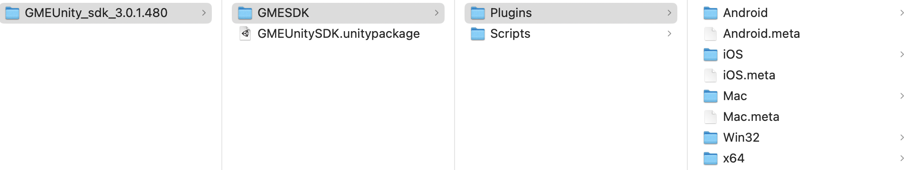
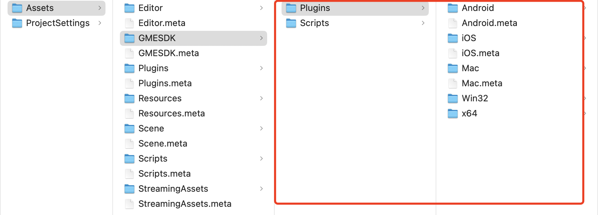
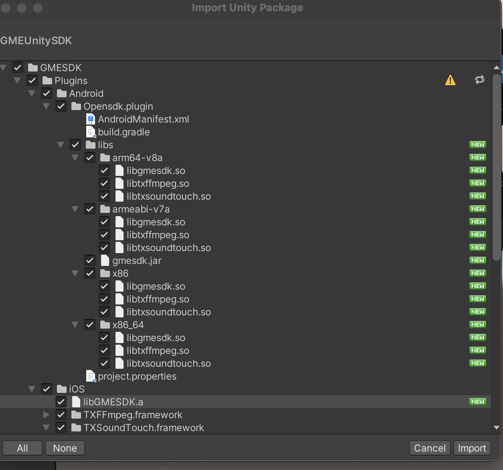
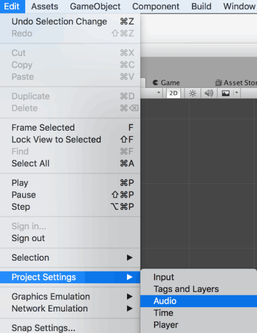
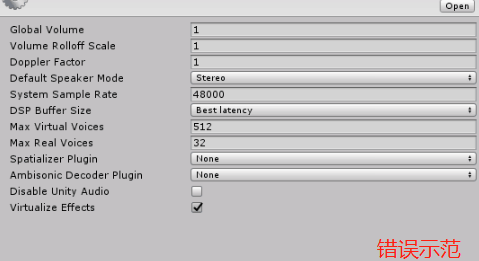
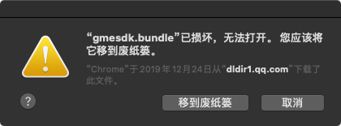
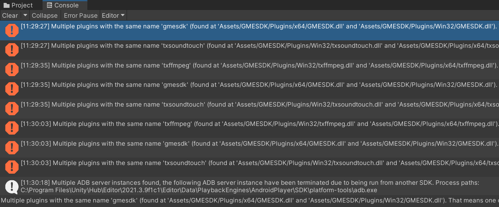
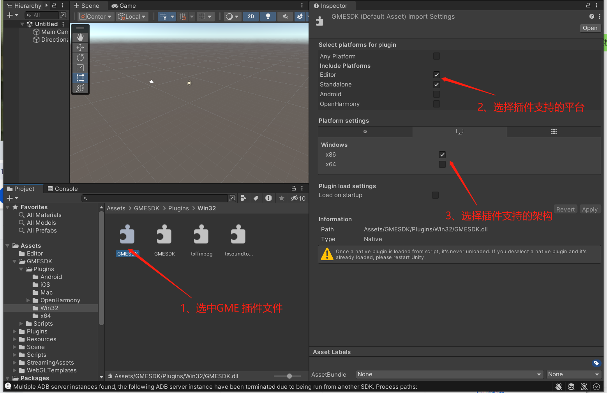

# Import SDK into Project

> **Note:**
> 
> This documentation applies to the **GME 3.X** SDK version. 

This guide helps Unity developers debug and integrate Tencent Cloud Game Multimedia Engine \(GME\) APIs by detailing how to import the SDK into Unity projects.

## Download SDK

1. Download the Demo and SDK. 
2. Find the Unity SDK resources in the download interface.
3. Click to download. After extracting the SDK package, you will see the following components:

   



4. The files are described in the table below:
   | File Name | Description | Purpose |
   | --- | --- | --- |
   | GMESDK | SDK header files and library files | Provides API interfaces. The SDK library is packaged as a plugin and must be manually imported into your project. |
   | GMEUnitySDK.unitypackage | SDK library file | Packaged as a unitypackage for automatic import. |
   > **Platform Support Note:**
   > 
   > The Unity SDK supports Windows, Mac, Android, and iOS platforms.

## Import Unity SDK

### Manual Import

#### Import Plugins and SDK Header Files

Copy the files from the GMESDK folder in the development toolkit to your Unity project’s Assets folder, as shown below.



### Automatic Import

1. Double-click the GMEUnitySDK.unitypackage file in the development toolkit. A dialog box will appear as shown below:

   



2. Select the platforms your project will support and click Import.
   > **Note:**
   > 
   > If you do not need to export win32 executable files, delete the x86 folder under the Plugins directory.

## FAQs

### Android Obfuscation

Add the following rule to your ProGuard configuration file:

```java
-keep class com.gme.** { *; }
```

### iOS Audio Interruption

In the Unity Editor, go to **Edit \> Project Setting \> Audio** and use the default system settings. Modifying these settings may cause Unity audio playback to be interrupted on iOS due to hardware buffer configuration, as shown below:



> **Prohibited:**
> 
> Do not modify the Audio module in Project Settings.

If you configure as shown below, Unity audio playback may be interrupted on iOS due to hardware buffer configuration:



### MacOS File Corruption Warning

When integrating the GME SDK with Unity on MacOS, you may encounter a file corruption error during runtime caused by the com.apple.quarantine attribute:



To resolve this, remove the com.apple.quarantine attribute:

- Step 1: Open the terminal and navigate to your project folder: Unity\_OpenSDK\_Audio/Assets/Plugins/.
- Step 2: Run the following command:
  ```bash
  $ xattr -d com.apple.quarantine gmesdk.bundle
  ```

### Windows Multiple Plugins with Same Name

After importing the GME SDK, you may see "Multiple plugins with the same name 'xxxx'" in the Unity Editor Console.



This occurs because the GME SDK provides both 32-bit and 64-bit dynamic libraries for Windows. Delete the unnecessary architecture based on your project requirements.

### Runtime Error: GME SDK Not Found

When running the packaged application, you may see an error indicating the GME dynamic library cannot be found: DllNotFoundException. Unable to load DLL 'gmesdk'. This means the GME SDK was not included in the application package. Verify that the GME SDK is present in your application. If not, configure your Unity Editor as shown below:

