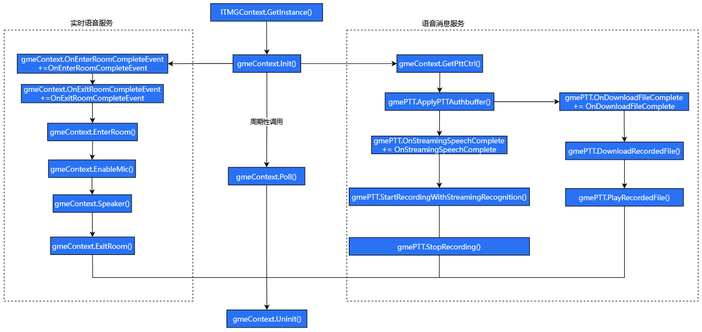

# 接入实时语音

This guide explains how to integrate GME real-time voice into your project. It covers basic functionality for demonstration purposes. For advanced features, refer to the API documentation.

## Prerequisites

- Create a GME application and obtain your SDKAppID and SecretKey. 
- Activate the GME real-time voice service. 
- Import the GME SDK into your project. See [Unity Engine Import SDK to Project](Import-SDK-into-Project.md#import-unity-sdk).

## API Call Flowchart



## Implementation Guide

### Step 1: Import Header File

```csharp
using GME;
```

### Step 2: Initialize SDK

Initialize the SDK before using any GME features.

```csharp
int ret = ITMGContext.GetInstance().Init(sdkAppId, openID);
if (ret == AV_OK) {
    // Initialization succeeded
} else {
    // Initialization failed
}
```

| Parameter Name | Type | Description |
| --- | --- | --- |
| sdkAppId | string | AppID provided by GME in the [Tencent Cloud Console](https://cloud.tencent.com/login?s_url=https%3A%2F%2Fconsole.cloud.tencent.com%2Fgamegme). |
| openID | string | Username. Only letters \(a-z, A-Z\), numbers \(0-9\), underscores, and hyphens are allowed, up to 127 characters. Note: GME does not support the same userId joining a room from two devices at the same time; this will cause interference. |

### Step 3: Trigger Event Callbacks

Call the [Poll](API/ITMGContext.md#poll) interface periodically \(for example, every 30ms\) to trigger GME event callbacks. [Poll](API/ITMGContext.md#poll) acts as GME's message pump. GME requires regular [Poll](API/ITMGContext.md#poll) calls to process event callbacks. If you do not call [Poll](API/ITMGContext.md#poll), the SDK will not function correctly. For implementation details, refer to EnginePollHelper in the GME sample code.

```csharp
public void Update()
{
    ITMGContext.GetInstance().Poll();
}
```

### Step 4: Listen for Room Entry and Exit Notifications

#### Room Entry Notification

```csharp
ITMGContext.GetInstance().OnEnterRoomCompleteEvent += OnEnterRoomComplete;
```

#### Room Exit Notification

```csharp
ITMGContext.GetInstance().OnExitRoomCompleteEvent += OnExitRoomCompleteEvent;
```

### Step 5: Generate Authentication Information

When joining a room, you must provide an authentication token \(UserSig\). This token is generated using SDKAppID, userId, and other information. For development and debugging, you can use the SDK interface to generate UserSig \(for easier migration from version 2.X, the SDK interface for calculating UserSig is still named `AuthBuffer`\). For production, generate authentication information on your server. For calculation methods, see the [UserSig Documentation](UserSig.md#usersig-overview).

| Parameter | Type | Description |
| --- | --- | --- |
| appId | int | AppID provided by GME in the [Tencent Cloud Console](https://cloud.tencent.com/login?s_url=https%3A%2F%2Fconsole.cloud.tencent.com%2Fgamegme).  |
| roomId | string | Room ID, up to 127 characters. |
| openId | string | Username. Only letters \(a-z, A-Z\), numbers \(0-9\), underscores, and hyphens are allowed, up to 127 characters. Note: GME does not support the same userId joining a room from two devices at the same time; this will cause interference. |
| key | string | SecretKey from the [Tencent Cloud Console](https://cloud.tencent.com/login?s_url=https%3A%2F%2Fconsole.cloud.tencent.com%2Fgamegme). |

```csharp
public static string GetAuthBuffer(string sdkAppID, string roomID, string userID, string authKey)
{
    string key = authKey;
    return QAVAuthBuffer.GenAuthBuffer(int.Parse(sdkAppID), roomID, userID, key);
}
```

### Step 6: Join Real-Time Voice Room

Call the [`EnterRoom`](API/ITMGContext.md#enterroom) interface to join a real-time voice room. A return value of `AV_OK` only indicates the function call succeeded.

```csharp
ITMGContext.GetInstance().EnterRoom(sRoomID, roomtype, authBuffer);
```

| Parameter Name | Type | Description |
| --- | --- | --- |
| roomID | string | Room ID, up to 127 characters. |
| roomtype | enum | Room type, representing audio quality. Each user can set their own room type without affecting others. Available types: - ITMG\_ROOM\_TYPE\_FLUENCY: Low-latency audio, suitable for gaming - ITMG\_ROOM\_TYPE\_STANDARD: Standard audio quality, moderate latency, suitable for social deduction games - ITMG\_ROOM\_TYPE\_HIGHQUALITY: High-definition audio, higher latency, suitable for entertainment co-hosting |
| authBuffer | string | Authentication token for room entry. See Step 5 for details. |

### Step 7: Handle Room Entry Completion Event

Joining a room is asynchronous. The GME SDK notifies your application of the result via an event callback. If the callback indicates success, room entry is complete.

```csharp
// Room entry completion event callback
void OnEnterRoomComplete(int err, string errInfo) {
    if (err != 0) {
        ShowLoginPanel("Error code:" + err + " Error info:" + errInfo);
        return;
    } else {
        // Room entry succeeded
    }
}
```

### Step 8: Enable or Disable Microphone

The microphone is disabled by default in the GME SDK. **After receiving the room entry completion event**, call the [`EnableMic`](API/ITMGAudioCtrl.md#enablemic) interface to enable or disable the microphone.

```csharp
ITMGContext.GetInstance().GetAudioCtrl().EnableMic(true);
```

### Step 9: Enable or Disable Speaker

The speaker is disabled by default in the GME SDK. **After receiving the room entry completion event**, call the [`EnableSpeaker`](API/ITMGAudioCtrl.md#enablespeaker) interface to enable or disable the speaker.

```csharp
ITMGContext.GetInstance().GetAudioCtrl().EnableSpeaker(true);
```

### Step 10: Exit Real-Time Voice Room

When you finish real-time voice communication, call `ExitRoom` to leave the room.

```csharp
ITMGContext.GetInstance().ExitRoom();
```

### Step 11: Handle Room Exit Completion Event

Exiting a room is asynchronous. The GME SDK notifies your application of the result via an event callback.

```csharp
void OnExitRoomComplete() {
    // Handle post-exit logic
}
```

### Step 12: Uninitialize SDK

When you are done using GME features, call the [`Uninit`](API/ITMGContext.md#uninit) interface to uninitialize the SDK.

> **Note:**
> 
> If you stop calling [`Poll`](API/ITMGContext.md#poll) immediately after calling [`Uninit`](API/ITMGContext.md#uninit), manually call [`Poll`](API/ITMGContext.md#poll) one last time before stopping to clear all internal SDK events. Otherwise, events may accumulate inside the SDK.

```csharp
ITMGContext.GetInstance().Uninit();
```

At this stage, GME real-time voice is integrated into your application. For additional features, refer to the API documentation.