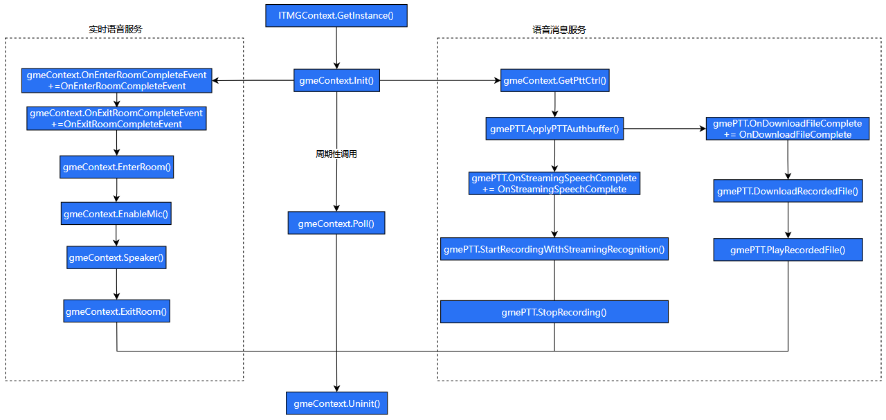

# Integrate Voice Message

> **Note:**
> 
> This documentation applies to **GME 3.X** SDK. 

This guide explains how to integrate GME Voice Message features into your project. This walkthrough covers only the basic functionality. For advanced features, refer to the API documentation.

## Prerequisites

- You have created a GME application and obtained the SDKAppID and SecretKey. 
- The GME Real-Time Voice service is activated. 
- The GME SDK is imported into your project. Refer to [Unity Engine Import SDK to Project](Import-SDK-into-Project.md#import-unity-sdk).

## API Call Flowchart



## Implementation Guide

### Step 1: Import GME Package

```
using GME;
```

### Step 2: Initialize SDK

Initialize the SDK before using any GME features. If you have already initialized it for real-time voice, you do not need to repeat this step.

```
int ret = ITMGContext.GetInstance().Init(sdkAppId, openID);
if (ret== AV_OK) {
// Initialization succeeded
} else {
// Initialization failed
}
```

| Parameter Name | Type | Description |
| --- | --- | --- |
| sdkAppId | string | AppID provided by GME service from [Tencent Cloud Console](https://cloud.tencent.com/login?s_url=https%3A%2F%2Fconsole.cloud.tencent.com%2Fgamegme).  |
| openID | string | Username. Only English letters \(a-z, A-Z\), numbers \(0-9\), underscores, and hyphens are allowed, up to 127 characters. Note: GME does not support the same userId joining a room from two different devices at the same time; this will cause interference. |

### Step 3: Trigger Event Callbacks

Call the [Poll](API/ITMGContext.md#poll) interface periodically \(for example, every 30ms\) to trigger GME event callbacks. [Poll](API/ITMGContext.md#poll) acts as GME's message pump; regular [Poll](API/ITMGContext.md#poll) calls are required for event callback processing. If [Poll](API/ITMGContext.md#poll) is not called, the SDK will not function properly. See the EnginePollHelper implementation in the GME sample code.

```csharp
public void Update()
{
    ITMGContext.GetInstance().Poll();
}
```

### Step 4: Generate Authentication Information

Before using the Voice Message service, set the authentication token \(UserSig\), which is generated from SDKAppID and userId. For development and debugging, you can use the SDK interface to generate userSig \(for easier upgrade from 2.X, the SDK interface for UserSig calculation is still named AuthBuffer\). For production, generate authentication information on your server. For calculation details, see [UserSig Related](UserSig.md#usersig-overview).

| Parameter | Type | Description |
| --- | --- | --- |
| appId | int | AppID number provided by GME service from [Tencent Cloud Console](https://cloud.tencent.com/login?s_url=https%3A%2F%2Fconsole.cloud.tencent.com%2Fgamegme).  |
| roomId | string | Not used for Voice Message service; pass an empty string |
| openId | string | Username. Only English letters \(a-z, A-Z\), numbers \(0-9\), underscores, and hyphens are allowed, up to 127 characters. Note: GME does not support the same userId joining a room from two different devices at the same time; this will cause interference |
| key | string | SecretKey from [Tencent Cloud Console](https://cloud.tencent.com/login?s_url=https%3A%2F%2Fconsole.cloud.tencent.com%2Fgamegme) |

```csharp
public static string GetAuthBuffer(string sdkAppID, string roomID, string userID, string authKey)
{
    string key = authKey;
    return QAVAuthBuffer.GenAuthBuffer(int.Parse(sdkAppID), roomID, userID, key);
}
```

### Step 5: Set Authentication Information for Voice Message Service

```csharp
ITMGContext.GetInstance().GetPttCtrl().ApplyPTTAuthbuffer(userSig);
```

| Parameter | Type | Description |
| --- | --- | --- |
| userSig | string | Authentication information generated in Step 4 |

### Step 6: Listen for Voice Message Notifications

```csharp
ITMGContext.GetInstance().GetPttCtrl().OnStreamingSpeechComplete += OnStreamingSpeechComplete;
// Set the following callbacks as needed
//ITMGContext.GetInstance().GetPttCtrl().OnRecordFileComplete += OnRecordFileComplete;
//ITMGContext.GetInstance().GetPttCtrl().OnUploadFileComplete += OnUploadFileComplete;
//ITMGContext.GetInstance().GetPttCtrl().OnDownloadFileComplete += OnDownloadFileComplete;
//ITMGContext.GetInstance().GetPttCtrl().OnDownloadFileAuditComplete += OnDownloadFileAuditComplete;
//ITMGContext.GetInstance().GetPttCtrl().OnPlayFileComplete += OnPlayFileComplete;
//ITMGContext.GetInstance().GetPttCtrl().OnSpeechToTextComplete += OnSpeechToTextComplete;
//ITMGContext.GetInstance().GetPttCtrl().OnSpeechToTextAuditComplete += OnSpeechToTextAuditComplete;
```

### Step 7: Start Recording Voice Message

Call the [StartRecordingWithStreamingRecognition](API/ITMGPTT.md#startrecordingwithstreamingrecognition) interface to begin recording a voice message. This interface **automatically uploads the voice data to the GME server and performs speech recognition** during recording. After you call the [StopRecording](API/ITMGPTT.md#stoprecording) interface to end recording, the GME SDK returns the recognized text and the download URL for the voice file via the OnStreamingSpeechComplete callback. If you only need to record a voice message without speech recognition, use the [StartRecording](API/ITMGPTT.md#startrecording) interface.

```csharp
ITMGContext.GetInstance().StartRecordingWithStreamingRecognition(recordedFilePath);
```

| Parameter Name | Type | Description |
| --- | --- | --- |
| recordedFilePath | string | Local path to save the recording file. Must end with .ogg |

### Step 8: Stop Recording

Call the [StopRecording](API/ITMGPTT.md#stoprecording) interface to stop recording. The result is returned via the OnStreamingSpeechComplete callback set in Step 6. Callback parameters include error code, voice file download URL, and recognized text. You can share the voice file download URL with remote users through your Chat channel.

```csharp
ITMGContext.GetInstance().StopRecording();
```

### Step 9: Download Voice File

The download URL generated by the GME SDK requires authentication. Use the SDK-provided [DownloadRecordedFile](API/ITMGPTT.md#downloadrecordedfile) interface to download the file. When the download completes, the OnDownloadFileComplete callback is triggered.

```csharp
IITMGContext.GetInstance().DownloadRecordedFile(fileId, filePath);
```

| Parameter Name | Type | Description |
| --- | --- | --- |
| fileId | string | Download URL for the voice file |
| filePath | string | Local path to save the voice file. Must end with .ogg |

### Step 10: Play Voice File

Play the voice file downloaded in Step 9 using [PlayRecordedFile](API/ITMGPTT.md#playrecordedfile). When playback finishes, the OnPlayFileComplete callback is triggered.

```csharp
ITMGContext.GetInstance().PlayRecordedFile(filePath);
```

| Parameter Name | Type | Description |
| --- | --- | --- |
| filePath | string | Local path to the recording file. Must end with .ogg |

### Step 11: Uninitialize SDK

When you are done using GME features, call the [Uninit](API/ITMGContext.md#uninit) interface to uninitialize the SDK.

> **Note:**
> 
> If you plan to stop calling [Poll](API/ITMGContext.md#poll) immediately after [Uninit](API/ITMGContext.md#uninit), call [Poll](API/ITMGContext.md#poll) one final time before stopping to clear all internal SDK events. Otherwise, events may accumulate inside the SDK.

```csharp
ITMGContext.GetInstance().Uninit();
```

At this point, GME Real-Time Voice is integrated into your application. For more features, see the API documentation.