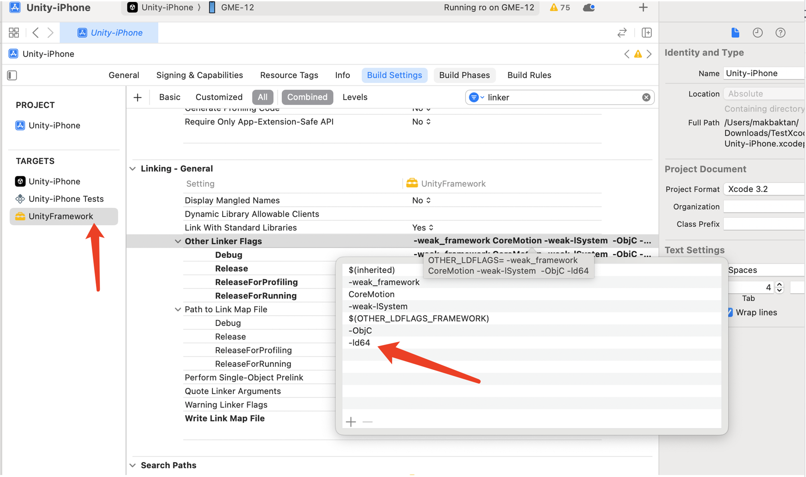

# Project Export Issues

## Exporting to iOS Platform

### Compilation Errors After Adding `GMESDK.framework` in Xcode

In your project file, open Build Settings. If "Other Linker Flags" includes the `-all_load` flag, remove it and recompile.

### `framework not found GMESDK` Error After Exporting Xcode Project from Unity

When using Unity, integrate the GME Unity SDK and use the `libGMESDK.a` library. Do not use the framework file.

### armv7 Error After Exporting iOS Executable with Unity SDK

- Upgrade your Unity version for compatibility. For details, see the [Unity official website](https://forum.unity.com/threads/undefined-symbols-for-architecture-armv7-query_call_back-callback_func_type.830544/#post-5590516).
- If upgrading is not required, exclude the armv7 architecture from your build.

### Unable to Run iOS Demo After Downloading

If you download the official iOS Demo and encounter errors such as `ld: warning: directory not found for option` when compiling in Xcode \(version 10 or later\), manually add the `GMESDK.framework` file from the `GME_SDK` directory \(located at the same level as the Demo\) to the Frameworks list in your project.

### Simulator Debugging Support for iOS SDK

Yes. Confirm using the [latest package from the official website](https://cloud.tencent.com/document/product/607/18521).

### Certificate Error When Exporting Demo

Error message:

```bash
Showing Recent Messages:-1: Unity-iPhone has conflicting provisioning settings. Unity-iPhone is automatically signed, but code signing identity iPhone Distribution: Tencent Technology (Shenzhen) Co., Ltd has been manually specified. Set the code signing identity value to "iPhone Developer" in the build settings editor, or switch to manual signing in the project editor. (in target 'Unity-iPhone')
```

Solution:

When exporting for a physical device, replace Tencent Cloud's enterprise certificate with your own developer certificate.

### Library Not Found Error When Exporting for Real Device

Error message:

```bash
dyld: Library not loaded: @rpath/libLamemp3.framework/libLamemp3
Referenced from: /private/var/containers/Bundle/Application/XXXX
Reason: image not found
dyld: launch, loading dependent libraries
DYLD_LIBRARY_PATH=/usr/lib/system/introspection
DYLD_INSERT_LIBRARIES=/Developer/usr/lib/libBacktraceRecording.dylib:/Developer/usr/lib/libMainThreadChecker.dylib:/Developer/Library/PrivateFrameworks/DTDDISupport.framework/libViewDebuggerSupport.dylib
```

Solution:

- If you are using a dynamic library, it is loaded by default under `Linked Frameworks and Libraries`. Select the library and click the `-` button to remove it. Then, click the `+` button under `Embedded Binaries` to add the dynamic library.
- Alternatively, modify the framework as shown below:
  

### Xcode 15 Compilation Error

Error message:

```
clang: error: unable to execute command: Abort trap: 6
clang: error: linker command failed due to signal (use -v to see invocation)
```

Solution:

Add `-ld64` to the linker options.



## Exporting to Windows Platform

### Error When Exporting PC Executable from Unity Demo

If you see errors like `Found plugins with same names and architectures`, it means the GME SDK includes both x86 and x86\_64 versions by default. Delete either the x86 or x86\_64 version from the plugins folder.

### Missing DLL Error When Exporting PC Executable from Unreal Demo

When exporting the Windows x64 version, after generating the executable, copy all DLL files from `UEDemo1\Plugins\GMESDK\Source\ThirdParty\GMESDKLibrary\x64` in your project directory to the same folder as the executable \(.exe\).

## Android Export Issues

### Black Screen After Integrating GME SDK and Exporting Apk

This issue is caused by missing library files. Unzip the Apk and verify that all library files are present in each folder under `lib`.

### Device Not Supported Error When Exporting to Android

This is related to the architectures included in the exported executable. If you do not need the v8a architecture, uncheck the v8a option in the export settings of your Unity project.

### Exported Apk Does Not Support Emulator

First, check if the exported Apk contains x86 library files. If not, re-download the SDK, import the x86 architecture SDK files, and export the executable again.

## Unity-WebGL Export Issues

### Protocol Requirements for Unity-WebGL Platform

The exported product must be deployed using the **https protocol**. Deploying with http protocol will cause functionality issues.

### 1004 Error When Joining a Room on Unity-WebGL Platform

A 1004 \(Invalid Argument\) error occurs when joining a room if the provided Openid is less than 10000. The **Openid must be greater than 10000**.

### Unity-WebGL Platform Compatibility with Mobile Devices

According to the Unity official website, products built for Unity-WebGL are not currently supported on mobile devices. See [Unity - Manual: WebGL Browser Compatibility \(unity3d.com\)](https://docs.unity3d.com/2020.1/Documentation/Manual/webgl-browsercompatibility.html).

### Support for Positional Voice on Unity-WebGL Platform

Currently, the WebGL platform only supports basic real-time voice communication features: join/leave room and microphone control. Unsupported features will return error code 1006 when called. The positional voice feature is being adapted for WebGL.