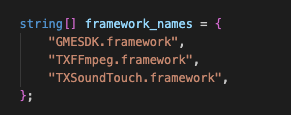
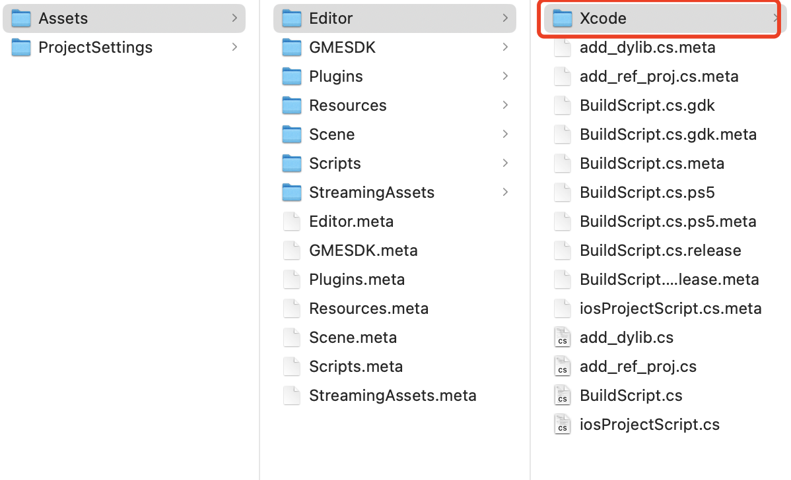
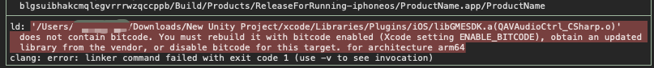

# Android & iOS &Windows工程导出

> **Note:**
> 
> This documentation applies to the **GME 3.X** SDK version. 

This guide helps Unity developers debug and integrate Tencent Cloud Game Multimedia Engine APIs by outlining export configurations for Unity projects.

## Exporting to iOS Platform

When exporting a Unity project to an Xcode project, you must configure the GME dynamic libraries. The setup process depends on your Unity version.

### Step 1. Handle Dynamic Libraries \(Unity 2019 and Later\)

#### Configuration Overview

Create an Editor OnPostprocessBuild script and use `UnityEditor.iOS.Xcode.Extensions.PBXProjectExtensions.AddFileToEmbedFrameworks`. This API automatically copies the dynamic libraries to the framework directory in the final bundle and signs them.

The business layer should import the following dynamic library frameworks:



### Sample Code

See the `add_dylib.cs` script in the Demo project. Place this code in your project's Editor folder as needed.

```csharp
[UnityEditor.Callbacks.PostProcessBuild(1002)]
    public  static void OnPostprocessBuild (UnityEditor.BuildTarget BuildTarget, string path){  
        if (BuildTarget == UnityEditor.BuildTarget.iOS) {
            UnityEngine.Debug.Log ("OnPostprocessBuild add_dylib:"+path);
#if UNITY_EDITOR_OSX || UNITY_STANDALONE_OSX
            {
                string projPath = UnityEditor.iOS.Xcode.PBXProject.GetPBXProjectPath (path);  
                UnityEditor.iOS.Xcode.PBXProject proj = new UnityEditor.iOS.Xcode.PBXProject ();  
                proj.ReadFromString (System.IO.File.ReadAllText (projPath));
                string targetGuid;
                #if UNITY_2019_1_OR_NEWER
                    targetGuid = proj.GetUnityMainTargetGuid(); // 2019
                #else
                    targetGuid = proj.TargetGuidByName (UnityEditor.iOS.Xcode.PBXProject.GetUnityTargetName ()); // 2018
                #endif

                string[] framework_names = {
                    "TXFFmpeg.framework",
                    "TXSoundTouch.framework",
                };
                
                for (int i = 0; i < framework_names.Length; i++)
                {
                    string framework_name = framework_names[i];
                    string dylibGuid = null;
                    dylibGuid = proj.FindFileGuidByProjectPath("Frameworks/GMESDK/Plugins/iOS/" + framework_name);
                    if (dylibGuid == null) {
                        UnityEngine.Debug.LogWarning (framework_name + " guid not found");
                    } else {
                        UnityEngine.Debug.LogWarning (framework_name + " guid:" + dylibGuid);
                        UnityEditor.iOS.Xcode.Extensions.PBXProjectExtensions.AddFileToEmbedFrameworks(proj, targetGuid, dylibGuid);
                        proj.AddBuildProperty(targetGuid, "LD_RUNPATH_SEARCH_PATHS", "@executable_path/Frameworks");
                        System.IO.File.WriteAllText (projPath, proj.WriteToString ());
                    }
                }
            }
#endif
        }
    }
```

### Step 2. Handle Dynamic Libraries \(Unity Versions Earlier than 2019\)

Only Unity 2019 and later support `UnityEditor.iOS.Xcode.Extensions`. For earlier versions, you can export the `UnityEditor.iOS.Xcode` package from a newer Unity version and use it in your older project, or download [UnityEditorAV.iOS.XCode.zip](https://dldir1.qq.com/hudongzhibo/QCloud_TGP/GME/GME2.9.0/Other/UnityEditorAV.iOS.XCode.zip). Extract the file and place it in your project's Editor folder.



### Step 3. Export Xcode Project

Make sure your Xcode version is 10.0 or above, then export the Xcode project from the Unity Editor.

### Step 4. Disable Bitcode

If you see the error below during compilation, disable Bitcode. In Xcode, go to Targets \> Build Settings, search for Bitcode, and set the option to NO.



### Step 5. Configure iOS Permissions

- Required background modes: Enables background operation \(optional\).
- Microphone Usage Description: Grants microphone access.

### Step 6. Add Missing System Libraries

If you encounter missing system library functions during compilation, add the following libraries:

```
CoreTelephony.framework
CoreServices.framework
```

### Step 7. Troubleshoot Export Issues

For troubleshooting, see [iOS Export Issues](Project-Export-Issues.md#exporting-to-ios-platform).

## Exporting to Android Platform

### Step 1. Remove Unused lib Files

The GME Unity SDK includes lib files for four architectures: arm64-v8a, armeabi-v7a, x86, and x86\_64. Remove any files that are not needed for your project.

> **Caution:**
> 
> If the generated Android APK is missing a required architecture, the app will crash.

If your APK shows a black screen or crashes at launch, it's likely due to missing lib files for the necessary architecture. Add or remove lib files as needed for your project.

### Step 2. Configure Permissions

The GME SDK requires the following permissions:

```xml
<uses-permission android:name="android.permission.RECORD_AUDIO" />
<uses-permission android:name="android.permission.ACCESS_NETWORK_STATE" />
<uses-permission android:name="android.permission.ACCESS_WIFI_STATE" />
<uses-permission android:name="android.permission.INTERNET" />
<uses-permission android:name="android.permission.MODIFY_AUDIO_SETTINGS" />
<uses-permission android:name="android.permission.BLUETOOTH"/>
<uses-permission android:name="android.permission.WRITE_EXTERNAL_STORAGE"/>
```

These permissions are already included in the GME Unity SDK Android plugin. No additional configuration is needed.

### Step 3. Troubleshoot Export Issues

For troubleshooting, see [Android Export Issues](Project-Export-Issues.md#android-export-issues).

## Exporting to Windows Platform

For troubleshooting, see [Windows Export Issues](Project-Export-Issues.md#exporting-to-windows-platform).