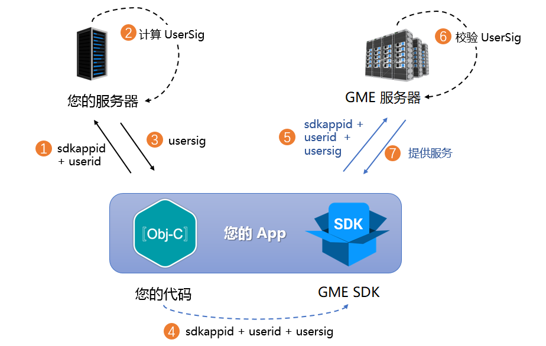

# UserSig

> **Note:**
> 
> This documentation applies to the **GME 3.X** SDK version. 

## UserSig Overview

UserSig is a security token developed by Tencent Cloud to protect your cloud service usage from unauthorized access. This mechanism is used across Tencent Cloud's Game Multimedia Engine 3.0 \(GME 3.0\), Real-Time Communication \(TRTC\), Chat \(IM\), and Mobile Live Video Broadcasting \(MLVB\) products. To initialize or log in with these SDKs, you must provide three essential parameters: SDKAppID, UserID, and UserSig. SDKAppID uniquely identifies your application, UserID identifies the user, and UserSig is a security token generated from these values. UserSig is created using the HMAC SHA256 algorithm. As long as attackers cannot forge a valid UserSig, your cloud service traffic remains secure. The UserSig generation process is illustrated below. It uses hash encryption on key data such as SDKAppID, UserID, and ExpireTime:

```cpp
// UserSig calculation formula. secretkey is the encryption key used to generate UserSig.

usersig = hmacsha256(secretkey, (userid + sdkappid + currtime + expire +
                                 base64(userid + sdkappid + currtime + expire)))
```

> **Note:**
> 
> - currtime is the current system time; expire is the signature expiration time.
> - The above diagram demonstrates the UserSig calculation principle. 

## Client-side UserSig Generation

During development and debugging, the GME SDK provides platform-specific interfaces to quickly generate UserSig. For production environments, always use the more secure server-side generation method.

\[C++\]

```cpp
// API prototype
// int GMESDK_CALL QAVSDK_AuthBuffer_GenAuthBuffer(unsigned int appId, const char* roomId, const char* userId, const char* key, unsigned char* authBuffer, unsigned int authBufferLen);

int userSigLen = 0;
unsigned char userSig[1024] = {0};
userSigLen  = QAVSDK_AuthBuffer_GenAuthBuffer(1400******, "", "1000", "key*****", userSig, userSigLen);
```

\[java\]

```
import com.gme.av.sig.AuthBuffer;

// API prototype
// public byte[] genAuthBuffer(int appId, String roomId, String userId, String appKey)

byte[] userSig;
userSig = AuthBuffer.getInstance().genAuthBuffer(1400******, "", "1000", "key*****");
```

\[Object-C\]

```html
#import "GMESDK/QAVAuthBuffer.h"

// API prototype
// + (NSData*)GenAuthBuffer:(unsigned int)appId roomID:(NSString*)roomID openID:(NSString*)openID key:(NSString*)key;

NSData* userSig = [QAVAuthBuffer GenAuthBuffer:1400****** roomID:@"" openID:@"1000" key:@"key*****"];
```

## Server-side UserSig Generation

For production use, GME recommends server-side UserSig generation to maximize SecretKey security. Server-side generation is far more secure than embedding keys in your app. Follow these steps:

1. Before initializing the SDK, request UserSig from your server.
2. Your server generates UserSig based on SDKAppID and UserID. See the calculation source code referenced above.
3. The server returns the generated UserSig to your app.
4. Your app passes the UserSig to the SDK via the designated API.
5. The SDK submits SDKAppID, UserID, and UserSig to the GME server for verification.
6. The GME server verifies the UserSig and confirms its validity.
7. If verification succeeds, the GME SDK is granted access to real-time audio services.

   



   To streamline your integration, UserSig generation source code is available in multiple languages:

|Language|Signature Algorithm|Signature API|Download Link|
| --- | --- | --- | --- |
|Java|HMAC-SHA256|[genUserSig](https://github.com/tencentyun/tls-sig-api-v2-java/blob/master/src/main/java/com/tencentyun/TLSSigAPIv2.java)|[Github](https://github.com/tencentyun/tls-sig-api-v2-java)|
|GO|HMAC-SHA256|[GenUserSig](https://github.com/tencentyun/tls-sig-api-v2-golang/blob/master/tencentyun/TLSSigAPI.go)|[Github](https://github.com/tencentyun/tls-sig-api-v2-golang)|
|PHP|HMAC-SHA256|[genUserSig](https://github.com/tencentyun/tls-sig-api-v2-php/blob/master/src/TLSSigAPIv2.php)|[Github](https://github.com/tencentyun/tls-sig-api-v2-php)|
|Node.js|HMAC-SHA256|[genUserSig](https://github.com/tencentyun/tls-sig-api-v2-node/blob/master/TLSSigAPIv2.js)|[Github](https://github.com/tencentyun/tls-sig-api-v2-node)|
|Python|HMAC-SHA256|[genUserSig](https://github.com/tencentyun/tls-sig-api-v2-python/blob/master/TLSSigAPIv2.py)|[Github](https://github.com/tencentyun/tls-sig-api-v2-python)|
|C\#|HMAC-SHA256|[genUserSig](https://github.com/tencentyun/tls-sig-api-v2-cs/blob/master/tls-sig-api-v2-cs/TLSSigAPIv2.cs)|[Github](https://github.com/tencentyun/tls-sig-api-v2-cs)|
|C++|HMAC-SHA256|[genUserSig](https://github.com/tencentyun/tls-sig-api-v2-cpp/blob/master/src/tls_sig_api_v2.h)|[Github](https://github.com/tencentyun/tls-sig-api-v2-cpp)|
